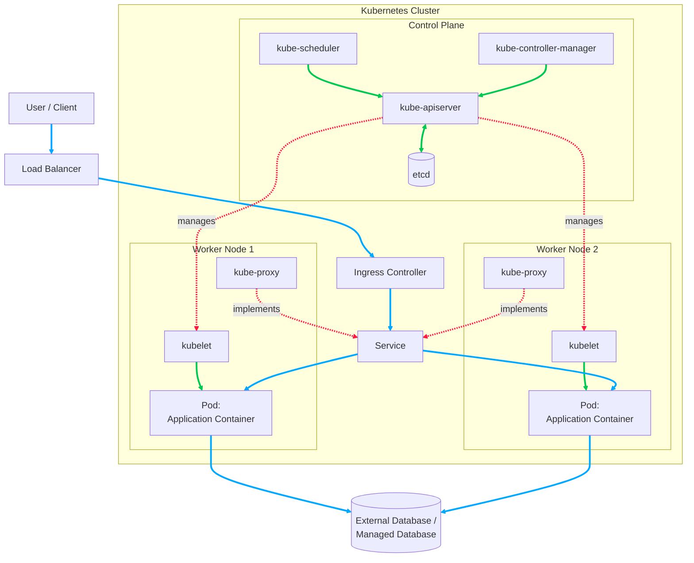
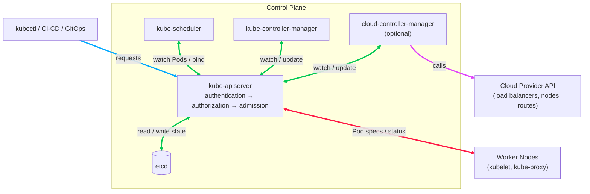
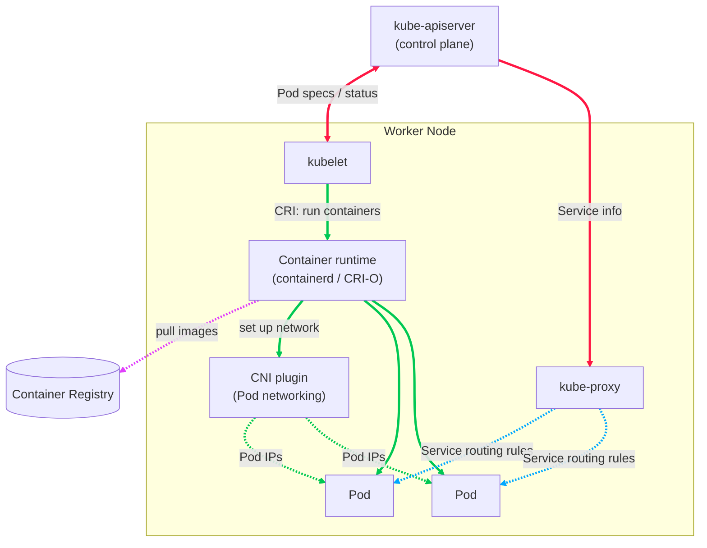
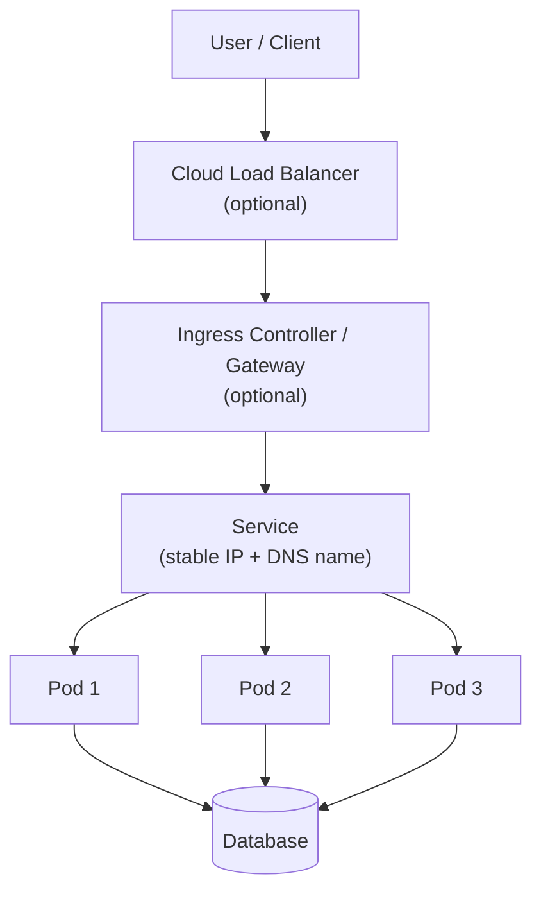

# Kubernetes Architecture

A clear overview of Kubernetes components, how they communicate, and how an application runs inside a cluster.

## 1. Architecture Diagrams

The first diagram shows the whole cluster in one view. The diagrams after it zoom in on each part in more detail.

### 1.1 Full Architecture



**Arrow colors:** blue = application traffic, green = communication within the control plane or a node, red = control from the API server to nodes.

> **Note:** This is a conceptual diagram. Ingress controllers, cloud load balancers, and database services are optional and depend on the cluster design. Solid arrows show application traffic: User → Load Balancer → Ingress Controller → Service → Pods → Database. Dotted arrows show control, not traffic. The API server manages each node's kubelet, which starts and monitors the Pods. kube-proxy gets Service information from the API server and *implements* the Service by programming networking rules on its node. The Service has no direct connection to the API server, and application traffic never passes through the API server.

### 1.2 Control Plane



**Arrow colors:** blue = user and tool requests, green = communication within the control plane, red = API server to worker nodes, pink = calls to external systems.

The **kube-apiserver** is the hub of the cluster. Every component talks to it, and none of them talk to each other directly.

- **Every request** goes through authentication, authorization (e.g. RBAC) and admission control before anything is saved.
- **etcd** is read and written only by the API server.
- **kube-scheduler** watches for Pods with no node assigned, picks a node, and writes that choice (a *binding*) back through the API server.
- **kube-controller-manager** watches objects through the API server and updates them to match the desired state, e.g. creating Pods for a ReplicaSet.
- **cloud-controller-manager** (cloud clusters only) watches the API server and calls the cloud provider's API to create load balancers, manage nodes and set up routes.
- **Worker nodes** (kubelet and kube-proxy) also connect to the API server. Section 1.3 shows them in detail.

### 1.3 Worker Node



**Arrow colors:** blue = Service traffic routing, green = communication within the node, red = control from the API server, pink = calls to external systems.

Every worker node runs these same components:

- **kubelet** gets the specs of Pods assigned to its node from the API server and reports node and Pod status back. It runs health probes and tells the container runtime what to run, through the Container Runtime Interface (CRI).
- **Container runtime** pulls images from the registry and starts the containers that make up each Pod. When it creates a Pod, it calls the CNI plugin to set up networking.
- **CNI plugin** gives each Pod its own IP address and connects it to the cluster network.
- **kube-proxy** gets Service and EndpointSlice information from the API server and programs the node's networking rules (iptables, IPVS or nftables), so traffic sent to a Service reaches the right Pods.

### 1.4 Traffic Flow



> **Note:** These are conceptual diagrams. Ingress controllers, Gateway implementations, cloud load balancers, and external databases are optional and depend on the cluster design. A Service is a virtual object, not a running process. kube-proxy (or a replacement such as an eBPF-based CNI) programs each node so that traffic sent to the Service reaches one of its **ready** Pods.

## 2. What Is Kubernetes?

Kubernetes (K8s) is an open-source container orchestration platform originally designed by Google and now maintained by the Cloud Native Computing Foundation (CNCF). It helps deploy, scale, and manage containerized applications across a group of machines called a **cluster**.

A Kubernetes cluster is made up of:
- **Control plane** — makes cluster-wide decisions (such as scheduling), stores cluster state, and detects and responds to changes.
- **Worker nodes** — run application Pods.

Kubernetes is **declarative**: you describe the *desired state* (for example, "run 3 replicas of this image"), and controllers continually work to make the *actual state* match it. This loop is called **reconciliation**.

## 3. Control Plane Components

| Component | Responsibility |
|---|---|
| **kube-apiserver** | Front end of the control plane and the only component that reads from and writes to etcd. Handles authentication, authorization (e.g. RBAC), and admission control for every request. `kubectl`, controllers, the scheduler, and kubelets all communicate through it. Scales horizontally. |
| **etcd** | Consistent, highly available distributed key-value store that holds all cluster state and configuration. Uses the Raft consensus algorithm, so it is usually run with an odd number of members (3 or 5) to maintain quorum. |
| **kube-scheduler** | Watches for newly created Pods with no assigned node and selects a suitable node based on resource requests, node selectors, affinity/anti-affinity, taints and tolerations, and topology spread constraints. It only *assigns* the node; the kubelet starts the Pod. |
| **kube-controller-manager** | Runs built-in controllers (Deployment, ReplicaSet, Node, Job, EndpointSlice, ServiceAccount, and others) that continually compare actual state with desired state and take corrective action. |
| **cloud-controller-manager** *(optional)* | Integrates Kubernetes with a cloud provider: provisions cloud load balancers for `LoadBalancer` Services, manages node lifecycle, and configures routes. Not present in most on-premises or local clusters. |

## 4. Worker Node Components

| Component | Responsibility |
|---|---|
| **kubelet** | Node agent that registers the node with the API server, watches for Pods assigned to it, and ensures their containers are running and healthy (including running probes). Reports node and Pod status back to the API server. |
| **Container runtime** | Pulls images and runs containers through the Container Runtime Interface (CRI). Common runtimes are **containerd** and **CRI-O**. Direct Docker Engine support (dockershim) was removed in Kubernetes 1.24, though images built with Docker still run normally. |
| **kube-proxy** *(common, but not universal)* | Watches Services and EndpointSlices and programs node networking rules (iptables, IPVS, or nftables) so Service traffic reaches the right Pods. Some CNI plugins, such as Cilium, can replace it entirely. |
| **CNI plugin** | Provides Pod networking so every Pod gets its own IP and can reach every other Pod without NAT. Examples: Calico, Cilium, Flannel, and cloud-specific plugins such as the AWS VPC CNI. |

**Pods** are not a node component themselves, but they run on worker nodes. A Pod is the smallest deployable Kubernetes unit and contains one or more closely related containers that share a network namespace (IP address and ports) and can share storage volumes.

### Common Cluster Add-ons

| Add-on | Responsibility |
|---|---|
| **CoreDNS** | Cluster DNS. Gives Services DNS names such as `my-svc.my-namespace.svc.cluster.local`. |
| **metrics-server** | Collects CPU and memory usage from kubelets. Required for `kubectl top` and for the Horizontal Pod Autoscaler using resource metrics. |
| **Ingress controller / Gateway implementation** | Implements Ingress or Gateway API routing rules (e.g. NGINX Ingress Controller, Kong, Traefik, HAProxy, Envoy Gateway, cloud provider controllers). |
| **CSI drivers** | Container Storage Interface drivers that let Kubernetes provision and attach storage from cloud or on-premises storage systems. |

## 5. Important Kubernetes Objects

### Workloads
- **Pod:** Runs one or more containers. Usually created by a higher-level controller rather than directly.
- **Deployment:** Manages replicated stateless Pods and supports rolling updates and rollbacks.
- **ReplicaSet:** Keeps the requested number of Pod replicas running; usually managed by a Deployment.
- **StatefulSet:** Manages stateful Pods that need stable network identities, ordered startup/shutdown, and per-replica persistent storage (e.g. databases, Kafka).
- **DaemonSet:** Runs one copy of a Pod on every (or selected) node — commonly used for log collectors, monitoring agents, and CNI components.
- **Job / CronJob:** Runs tasks to completion once or on a schedule.

### Networking
- **Service:** Provides a stable virtual IP and DNS name and load-balances traffic to matching, ready Pods. Main types:
  - `ClusterIP` (default) — reachable only inside the cluster.
  - `NodePort` — exposes the Service on a static port on every node.
  - `LoadBalancer` — provisions an external load balancer (usually via the cloud provider).
  - `ExternalName` — maps the Service to an external DNS name.
- **Ingress:** Defines HTTP/HTTPS routing rules (host- and path-based routing, TLS termination); requires an Ingress controller to implement them. The Ingress API is stable but frozen — new features go into the Gateway API.
- **Gateway API:** The newer, more expressive successor to Ingress (`GatewayClass`, `Gateway`, `HTTPRoute`, and other route types), with clearer role separation between infrastructure and application teams.
- **NetworkPolicy:** Controls which Pods can communicate with each other and with external endpoints. Only enforced if the CNI plugin supports it.

### Configuration and Storage
- **ConfigMap:** Stores non-sensitive configuration.
- **Secret:** Stores sensitive configuration data. By default, Secret values are only **base64-encoded, not encrypted**, in etcd. Enable encryption at rest, restrict access with RBAC, and consider an external secret manager; a Secret is not automatically secure just because it is a Kubernetes object.
- **PersistentVolume (PV) / PersistentVolumeClaim (PVC):** Represent and request persistent storage.
- **StorageClass:** Defines a class of storage and enables dynamic provisioning of PVs when a PVC is created.

### Cluster Organization and Access
- **Namespace:** Organizes and isolates resources within a cluster; many policies (RBAC, quotas) are namespace-scoped.
- **ServiceAccount:** Identity used by Pods when they talk to the API server.
- **Role / ClusterRole and RoleBinding / ClusterRoleBinding (RBAC):** Grant permissions to users, groups, and ServiceAccounts.
- **ResourceQuota / LimitRange:** Limit total resource usage per namespace and set default requests/limits for containers.

### Scaling and Availability
- **HorizontalPodAutoscaler (HPA):** Scales the number of Pod replicas based on metrics such as CPU, memory, or custom metrics.
- **PodDisruptionBudget (PDB):** Limits how many Pods of an application can be down at once during voluntary disruptions such as node drains.

## 6. How an Application Runs

1. A developer builds a container image and pushes it to a container registry.
2. A Deployment manifest is applied using `kubectl`, a CI/CD pipeline, or GitOps tooling (e.g. Argo CD, Flux).
3. The request reaches the **kube-apiserver**, which authenticates and authorizes it, runs admission controllers, validates the object, and stores the desired state in **etcd**.
4. The **Deployment controller** (in kube-controller-manager) notices the new Deployment and creates a **ReplicaSet**.
5. The **ReplicaSet controller** creates the required number of **Pod** objects. At this point the Pods exist in the API but are not yet assigned to a node (status `Pending`).
6. The **kube-scheduler** selects a suitable worker node for each unscheduled Pod and records that assignment (binding) through the API server.
7. The **kubelet** on the chosen node sees the Pod assigned to it and asks the **container runtime** to pull the image and start the containers. The CNI plugin gives the Pod an IP address.
8. The kubelet runs the configured startup, liveness, and readiness probes and reports Pod status back to the API server.
9. Once a Pod is **Ready**, the EndpointSlice controller adds it to the Service's endpoints, and kube-proxy (or its replacement) updates node rules so the **Service** routes traffic to it. External traffic may enter through a cloud load balancer and/or an Ingress controller or Gateway, depending on the setup.
10. Controllers keep reconciling: if a Pod or node fails, the ReplicaSet controller creates a replacement Pod to maintain the desired replica count, and the scheduler places it on a healthy node.

## 7. Request Flow (Simplified)

```text
Client
  |
  v
DNS resolves the application hostname
  |
  v
Cloud Load Balancer (if configured)
  |
  v
Ingress Controller / Gateway (if configured)
  |
  v
Service (ClusterIP virtual IP, implemented by kube-proxy or CNI)
  |
  +------> Pod replica 1  (only Pods that are Ready receive traffic)
  |
  +------> Pod replica 2
  |
  +------> Pod replica 3
```

Ingress is not mandatory. For example, a `LoadBalancer` Service can expose an application directly through a cloud load balancer, a `NodePort` Service exposes it on a port of every node, and a `ClusterIP` Service is reachable only inside the cluster by default.

Inside the cluster, Pods typically reach each other through Service DNS names (resolved by CoreDNS), for example `http://backend.my-namespace.svc.cluster.local`.

## 8. Installing an Ingress Controller and Gateway API

The Ingress and Gateway API objects do nothing on their own. Kubernetes only stores them; a separately installed controller reads them and routes the traffic. This repository has a separate set of files for each supported controller, so you pick one and apply only its folder.

### Manifest layout

```text
k8s-manifests/
├── quick-start/                 # Basic app: namespace, config, Deployment, Service, HPA, PDB
├── k8s/                         # Full example: every object in Section 5 (no Ingress/Gateway)
├── ingress-controllers/
│   └── nginx/                   # Ingress + NetworkPolicy for the F5 NGINX Ingress Controller
└── gateway-controllers/
    ├── kong/                    # GatewayClass, Gateway, HTTPRoute, NetworkPolicy for Kong
    └── envoy/                   # GatewayClass, Gateway, HTTPRoute, NetworkPolicy for Envoy Gateway
```

Each controller folder includes its own NetworkPolicy that lets that controller reach the app Pods. NetworkPolicies add up, so if you apply more than one controller folder, each of those controllers is allowed.

### Prerequisites

- A running cluster and `kubectl` configured to use it (`kubectl get nodes` works).
- [Helm](https://helm.sh/docs/intro/install/) 3.8 or newer, if you use the Helm options.
- For external access, a way to get a `LoadBalancer` IP: a cloud cluster (EKS, GKE, AKS), MetalLB on-premises, or `minikube tunnel` / `kubectl port-forward` on a local cluster.

> **Which NGINX controller?** There are two different projects with similar names. This guide uses the **F5 NGINX Ingress Controller** ([nginx/kubernetes-ingress](https://github.com/nginx/kubernetes-ingress)), which is actively maintained. The community **ingress-nginx** controller (kubernetes/ingress-nginx) has been retired by the Kubernetes project and no longer receives releases or security fixes, so don't use it for new clusters. The two use different annotations, so Ingress examples written for one don't always work on the other.

### 8.1 Deploy the application

Apply one of the two app sets first. Every controller option below routes traffic to the `my-app` Service they create.

```bash
kubectl apply -f quick-start/        # basic app
# or
kubectl apply -R -f k8s/             # full example

kubectl get pods,svc -n my-app
```

### 8.2 Choose a controller

| Option | API | Section | Files to apply |
|---|---|---|---|
| F5 NGINX Ingress Controller | Ingress | 8.3 | `ingress-controllers/nginx/` |
| Kong | Gateway API | 8.4 | `gateway-controllers/kong/` |
| Envoy Gateway | Gateway API | 8.5 | `gateway-controllers/envoy/` |

You only need one. Each section has a Helm option and a `kubectl` option.

### 8.3 Ingress with the F5 NGINX Ingress Controller

**1. Install the controller**

*Option A: Helm*

```bash
helm repo add nginx-stable https://helm.nginx.com/stable
helm repo update

helm install nginx-ingress nginx-stable/nginx-ingress \
  --namespace nginx-ingress \
  --create-namespace \
  --set controller.ingressClass.name=nginx \
  --set controller.service.type=LoadBalancer
```

*Option B: kubectl, using the manifests from the project's Git repository*

```bash
# Check https://github.com/nginx/kubernetes-ingress/releases for the latest version.
export NIC_VERSION=v5.0.0

git clone https://github.com/nginx/kubernetes-ingress.git --branch $NIC_VERSION --depth 1
cd kubernetes-ingress

# Custom resource definitions (VirtualServer, Policy, etc.)
kubectl apply -f https://raw.githubusercontent.com/nginx/kubernetes-ingress/$NIC_VERSION/deploy/crds.yaml

# Namespace, ServiceAccount and RBAC permissions
kubectl apply -f deployments/common/ns-and-sa.yaml
kubectl apply -f deployments/rbac/rbac.yaml

# NGINX configuration and the "nginx" IngressClass
kubectl apply -f deployments/common/nginx-config.yaml
kubectl apply -f deployments/common/ingress-class.yaml

# The controller itself, and a LoadBalancer Service in front of it
kubectl apply -f deployments/deployment/nginx-ingress.yaml
kubectl apply -f deployments/service/loadbalancer.yaml

cd ..
```

File paths in the repository can change between releases. If a command fails, follow the "Installation with Manifests" page for your version in the [NGINX Ingress Controller docs](https://docs.nginx.com/nginx-ingress-controller/).

Both options create an `nginx-ingress` namespace, the controller, a `LoadBalancer` Service and an IngressClass named `nginx`.

**2. Check that it is running**

```bash
kubectl get pods -n nginx-ingress
kubectl get ingressclass                 # should list "nginx"
kubectl get svc -n nginx-ingress         # EXTERNAL-IP is the address users connect to
```

**3. Apply the Ingress files**

```bash
kubectl apply -f ingress-controllers/nginx/
kubectl get ingress -n my-app
```

**4. Test it**

```bash
# Replace <EXTERNAL-IP> with the address from step 2.
curl -H "Host: my-app.example.com" http://<EXTERNAL-IP>/
```

For real traffic, create a DNS record pointing `my-app.example.com` at that address. To serve HTTPS, install [cert-manager](https://cert-manager.io/docs/installation/helm/) and uncomment the `tls:` section in `ingress-controllers/nginx/01-ingress.yaml`.

### 8.4 Gateway API with Kong

Gateway API has two parts: the **CRDs** (the `GatewayClass`, `Gateway` and `HTTPRoute` object types) and an **implementation** that acts on them. Kong's chart does not include the CRDs, so install them first.

**1. Install the Gateway API CRDs**

```bash
# Check the Kong docs for the Gateway API versions your Kong release supports.
kubectl apply --server-side \
  -f https://github.com/kubernetes-sigs/gateway-api/releases/download/v1.3.0/standard-install.yaml

kubectl get crd | grep gateway.networking.k8s.io
```

**2. Install Kong (Kong Ingress Controller + Kong Gateway)**

*Option A: Helm*

```bash
helm repo add kong https://charts.konghq.com
helm repo update

helm install kong kong/ingress \
  --namespace kong \
  --create-namespace
```

*Option B: kubectl, with a manifest file you keep in Git*

Kong no longer publishes ready-made "all-in-one" manifests for current releases of the Kong Ingress Controller (3.x); its supported install methods are Helm and the Kong Operator. To install with `kubectl`, render the chart into a plain YAML file once, review it, commit it to your Git repository, and apply it with `kubectl`. After that, installs and upgrades don't need Helm on the cluster, which suits GitOps tools such as Argo CD and Flux.

```bash
helm repo add kong https://charts.konghq.com
helm repo update

kubectl create namespace kong
helm template kong kong/ingress --namespace kong > kong-install.yaml

# Review kong-install.yaml, commit it to Git, then:
kubectl apply -n kong -f kong-install.yaml
```

Both options create a `kong` namespace with the Kong controller, the Kong Gateway proxy, and a `LoadBalancer` Service named `kong-gateway-proxy`.

```bash
kubectl get pods -n kong
kubectl get svc -n kong kong-gateway-proxy
```

**3. Apply the Kong Gateway files**

```bash
kubectl apply -f gateway-controllers/kong/
```

This creates the `kong` GatewayClass, the `kong-gateway` Gateway, the `my-app-kong` HTTPRoute, and a NetworkPolicy that allows traffic from the `kong` namespace.

**4. Check status and get the address**

```bash
kubectl get gatewayclass kong           # ACCEPTED should be True
kubectl get gateway kong-gateway -n my-app   # PROGRAMMED should be True
kubectl get httproute -n my-app

export PROXY_IP=$(kubectl get svc -n kong kong-gateway-proxy \
  -o jsonpath='{.status.loadBalancer.ingress[0].ip}')
```

On AWS, load balancers get a hostname instead of an IP. Use `{.status.loadBalancer.ingress[0].hostname}` there.

**5. Test it**

```bash
curl -H "Host: my-app.example.com" http://$PROXY_IP/
curl -H "Host: my-app.example.com" http://$PROXY_IP/api   # matches the /api rule
```

### 8.5 Gateway API with Envoy Gateway

Envoy Gateway is a CNCF project built only for Gateway API. Both install options below include the Gateway API CRDs, so you don't install them separately.

**1. Install Envoy Gateway**

*Option A: Helm*

```bash
# Check https://github.com/envoyproxy/gateway/releases for the latest version.
helm install eg oci://docker.io/envoyproxy/gateway-helm \
  --version v1.5.0 \
  --namespace envoy-gateway-system \
  --create-namespace
```

*Option B: kubectl, using the release manifest from GitHub*

```bash
kubectl apply --server-side \
  -f https://github.com/envoyproxy/gateway/releases/download/v1.5.0/install.yaml
```

**2. Check that it is running**

```bash
kubectl wait --timeout=5m -n envoy-gateway-system \
  deployment/envoy-gateway --for=condition=Available

kubectl get crd | grep gateway.networking.k8s.io
```

**3. Apply the Envoy Gateway files**

```bash
kubectl apply -f gateway-controllers/envoy/
```

This creates the `envoy` GatewayClass, the `envoy-gateway` Gateway, the `my-app-envoy` HTTPRoute, and a NetworkPolicy that allows traffic from the `envoy-gateway-system` namespace. Envoy Gateway then creates the proxy Pods and a `LoadBalancer` Service for the Gateway in `envoy-gateway-system`.

**4. Check status and get the address**

```bash
kubectl get gatewayclass envoy               # ACCEPTED should be True
kubectl get gateway envoy-gateway -n my-app  # PROGRAMMED should be True, ADDRESS filled in
kubectl get httproute -n my-app

export GATEWAY_IP=$(kubectl get gateway envoy-gateway -n my-app \
  -o jsonpath='{.status.addresses[0].value}')
```

**5. Test it**

```bash
curl -H "Host: my-app.example.com" http://$GATEWAY_IP/
curl -H "Host: my-app.example.com" http://$GATEWAY_IP/api   # matches the /api rule
```

### 8.6 Other Maintained Ingress and Gateway API Controllers

These controllers are also actively developed and receive security fixes. Most now support Gateway API, which the Kubernetes project recommends for new setups. If you are moving away from the retired ingress-nginx, the [ingress2gateway](https://github.com/kubernetes-sigs/ingress2gateway) tool converts existing Ingress objects into Gateway API objects.

| Controller | Maintained by | Ingress | Gateway API | Install with |
|---|---|---|---|---|
| **F5 NGINX Ingress Controller** | F5 / NGINX | Yes | No (use NGINX Gateway Fabric) | Helm, kubectl manifests |
| **NGINX Gateway Fabric** | F5 / NGINX | No | Yes | Helm, kubectl manifests |
| **Kong Ingress Controller** | Kong | Yes | Yes | Helm, Kong Operator |
| **Envoy Gateway** | Envoy project (CNCF) | No | Yes | Helm, kubectl manifest |
| **Traefik** | Traefik Labs | Yes | Yes | Helm, kubectl manifests |
| **HAProxy Kubernetes Ingress Controller** | HAProxy Technologies | Yes | Partial | Helm, kubectl manifests |
| **Istio** | Istio project (CNCF) | Yes | Yes | istioctl, Helm |
| **Cilium** | Cilium project (CNCF) | Yes | Yes | cilium CLI, Helm (part of the Cilium CNI) |
| **Cloud controllers** (AWS Load Balancer Controller, GKE, Azure Application Gateway for Containers) | Cloud provider | Yes | Yes (varies by provider) | Cloud console / Helm / add-on |

Support status and feature coverage change over time, so check each project's release notes and security policy before choosing.

### 8.7 Local clusters (minikube, kind)

Local clusters have no cloud load balancer, so `EXTERNAL-IP` stays `<pending>`. Either run `minikube tunnel` in a separate terminal, or port-forward to the controller's Service and test against localhost:

```bash
# NGINX Ingress Controller: find its Service name, then port-forward to it.
kubectl get svc -n nginx-ingress
kubectl port-forward -n nginx-ingress svc/<service-name> 8080:80
curl -H "Host: my-app.example.com" http://localhost:8080/

# Kong
kubectl port-forward -n kong svc/kong-gateway-proxy 8081:80
curl -H "Host: my-app.example.com" http://localhost:8081/

# Envoy Gateway: find the Service it created for the Gateway, then port-forward to it.
kubectl get svc -n envoy-gateway-system
kubectl port-forward -n envoy-gateway-system svc/<service-name> 8082:80
curl -H "Host: my-app.example.com" http://localhost:8082/
```

### 8.8 Uninstall

First remove the routing files you applied:

```bash
kubectl delete -f ingress-controllers/nginx/      # NGINX
kubectl delete -f gateway-controllers/kong/       # Kong
kubectl delete -f gateway-controllers/envoy/      # Envoy Gateway
```

Then remove the controller. If you installed with Helm:

```bash
helm uninstall nginx-ingress -n nginx-ingress
helm uninstall kong -n kong
helm uninstall eg -n envoy-gateway-system
```

If you installed with kubectl:

```bash
# NGINX Ingress Controller (run inside the cloned kubernetes-ingress folder)
kubectl delete -f deployments/service/loadbalancer.yaml \
               -f deployments/deployment/nginx-ingress.yaml \
               -f deployments/common/ingress-class.yaml \
               -f deployments/common/nginx-config.yaml \
               -f deployments/rbac/rbac.yaml \
               -f deployments/common/ns-and-sa.yaml

# Kong
kubectl delete -n kong -f kong-install.yaml
kubectl delete namespace kong

# Envoy Gateway
kubectl delete -f https://github.com/envoyproxy/gateway/releases/download/v1.5.0/install.yaml
```

The Helm commands don't delete CRDs. Remove CRDs only when nothing in the cluster uses them any more.

## 9. High Availability and Scaling

- Run control-plane components across multiple machines (commonly three) for a highly available control plane where supported. Managed services (EKS, GKE, AKS) handle this for you.
- Run etcd with an odd number of members (3 or 5) so it can tolerate failures while keeping quorum.
- Use multiple worker nodes and spread replicas across nodes or zones using pod anti-affinity or topology spread constraints.
- Set resource requests and limits for containers so the scheduler can place Pods correctly and noisy neighbors are contained.
- Configure readiness, liveness, and startup probes appropriately.
- Use a Horizontal Pod Autoscaler (HPA) to scale Pod replicas when metrics and workload configuration support it (requires metrics-server or another metrics source).
- Use the Cluster Autoscaler or Karpenter to add and remove nodes based on pending Pods; consider the Vertical Pod Autoscaler (VPA) to right-size requests.
- Use PodDisruptionBudgets to help limit voluntary disruptions.
- Back up `etcd` (and application data in persistent volumes, e.g. with Velero) and regularly test cluster recovery procedures.
- Monitor cluster and application health using tools such as Prometheus and Grafana, and centralize logs (e.g. Loki, Elasticsearch/OpenSearch, or Fluent Bit forwarding to a log backend).

## 10. Security Basics

- Use **RBAC** with least-privilege permissions for users and ServiceAccounts.
- Enforce **Pod Security Standards** (Privileged / Baseline / Restricted) with Pod Security Admission.
- Restrict Pod-to-Pod traffic with **NetworkPolicies**.
- Enable **encryption at rest** for Secrets and protect access to etcd.
- Run containers as non-root, with read-only root filesystems where possible.
- Scan images for vulnerabilities and pull only from trusted registries.
- Keep the cluster version up to date; each Kubernetes minor release is supported for roughly 14 months.

## 11. Useful Commands

```bash
# View cluster nodes
kubectl get nodes -o wide

# View namespaces
kubectl get namespaces

# View Pods across all namespaces
kubectl get pods -A -o wide

# View Deployments and Services in the current namespace
kubectl get deployments,services

# Apply a manifest (create or update resources)
kubectl apply -f deployment.yaml

# Watch a rollout and roll back if needed
kubectl rollout status deployment/<deployment-name>
kubectl rollout undo deployment/<deployment-name>

# Scale a Deployment
kubectl scale deployment/<deployment-name> --replicas=3

# Inspect a Pod
kubectl describe pod <pod-name>

# View container logs (-c for a specific container, --previous for a crashed container)
kubectl logs <pod-name>
kubectl logs <pod-name> -c <container-name> --previous

# Open a shell inside a running container
kubectl exec -it <pod-name> -- sh

# Forward a local port to a Pod or Service for testing
kubectl port-forward svc/<service-name> 8080:80

# View resource usage (requires metrics-server)
kubectl top nodes
kubectl top pods

# View recent events
kubectl get events --sort-by=.metadata.creationTimestamp

# View control-plane and core service endpoints
kubectl cluster-info

# View the current kubeconfig context
kubectl config current-context
```

## 12. Summary

The **control plane** stores the desired state of the cluster and decides what should run and where. **Worker nodes** run Pods using the kubelet and a container runtime. Kubernetes controllers continually reconcile the actual cluster state with the desired state, the scheduler places Pods on nodes, and Services (with optional Ingress or Gateway API) provide stable networking for application Pods.

---

**Tip:** GitHub renders Mermaid diagrams in Markdown files. If your Markdown viewer does not support Mermaid, use the text-based request-flow diagram in Section 7.
